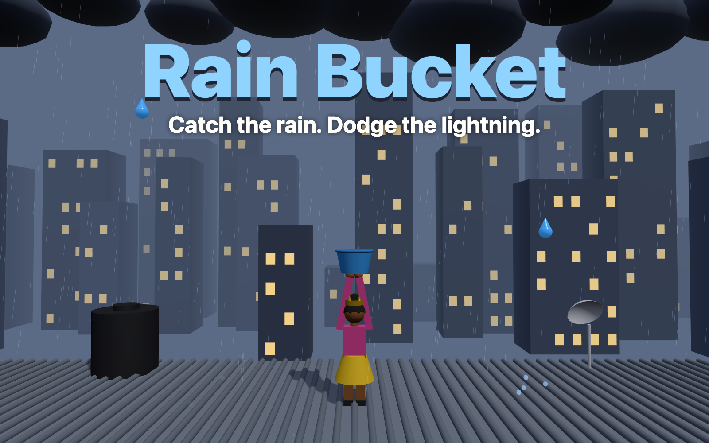

# Rain Bucket

A three.js game for [start.ng](https://start.ng). It's raining on a Lagos rooftop: move your start.ng character left and right to catch raindrops in your bucket, and dodge the lightning.

**Play:** https://rain-bucket.start.ng



## How to play

| | |
| --- | --- |
| Raindrop | +1 |
| Golden drop | +5 |
| Lightning | lose one of your 3 lives |

Move with the arrow keys or A / D, or drag with your finger or mouse. The rain gets faster and the lightning more frequent the longer you last.

### Bonuses

| Bonus | What it does |
| --- | --- |
| Combo | Keep catching (no 3-second gap, no lightning hit) to multiply points: ×2 at 10, ×3 at 25, ×4 at 50 |
| Bucket full | Every 40 drops in the bucket: +25 and it empties |
| ❤ Heart | Gives back a life (only falls when you've lost one) |
| 🛡 Shield | A bubble that bounces lightning off you for 7 seconds, +3 per bolt blocked |
| 🪣 Big bucket | A wider bucket for 8 seconds |
| ⭐ Star | Double points for 8 seconds (stacks with your combo) |

## How it uses start.ng

- **Your character:** the game asks start.ng who's playing (`startng:whoami` through the hidden `start.ng/connect` page) and builds a 3D version of your character from your `style`: body, top and bottom colours, skin, hair style and colour, hat and accessory. Change your look on start.ng and come back to the tab: the game picks up the new look straight away. Guests play as start.ng's guest look and get a Sign in button.
- **Profile card:** your face picture, character name and `@account` sit at the top left.
- **Leaderboard:** signed-in players' best runs are saved to start.ng with two columns, set in `startng.json`: points, then time survived.

## Files

| File | What it does |
| --- | --- |
| `index.html`, `style.css` | The page, menus and HUD |
| `game.js` | The scene, falling drops and lightning, controls, scoring |
| `character.js` | Builds the 3D character from a start.ng `style` |
| `startng.js` | Talks to start.ng (who's playing, sign in, scores, leaderboard) |
| `startng.json` | Leaderboard columns |
| `cover.png` | The card picture on start.ng (1600 × 1000) |

No build step: three.js loads from jsDelivr. To run it locally, serve the folder (for example `python3 -m http.server`) and open it. Sign-in and scores only work on `rain-bucket.start.ng`. To preview any character locally, add `?style=` with a start.ng style as JSON, for example:

```
http://localhost:8000/?style={"body":"female","hair":"braids","hat":"crown","primaryColor":"#a55eea"}
```

Made by Nwodoh Hilary (Team Endor, HNG 15).
